  <picture>
    <source media="(prefers-color-scheme: dark)" srcset="https://raw.githubusercontent.com/DangoKangoo/DangoKangoo/output/github-snake-dark.svg" />
    
  </picture>

Hi, I'm Will, a software engineer. I build websites, Shopify stores and machine learning projects for clients across the country, and I'm open to new work. If you have a project or a role in mind, get in touch.

Lately I've been doing a lot of computer vision, taking models from research into apps people actually use. Away from work I'm a golfer, hiker, runner and weightlifter.

  <a href="https://www.linkedin.com/in/will-odriscoll"><picture><source media="(prefers-color-scheme: light)" srcset="assets/btn-linkedin-light.svg" /></picture></a>
  <a href="mailto:willod17@outlook.com"><picture><source media="(prefers-color-scheme: light)" srcset="assets/btn-email-light.svg" /></picture></a>

### Currently building

<a href="https://github.com/DangoKangoo/keel"><picture><source media="(prefers-color-scheme: light)" srcset="assets/keel-logo-on-light.svg" /></picture></a>

A personal training app that plans running and strength training together as one long-term programme. It pulls data from Garmin Connect and Hevy, merges sessions recorded in both, and builds training blocks toward a goal race.

If Keel is useful to you, a coffee helps keep it going:

  

<picture>
  <source media="(prefers-color-scheme: light)" srcset="assets/tools-light.svg" />
  
</picture>
