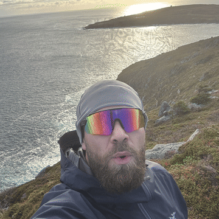

<table>
<tr>
<td width="62%" valign="top">

### 👋 Hey, I'm Will

- 🧠 Building **ML / computer vision** models: skin-lesion classification, diffusion augmentation, solar panel inspection
- 🌐 Shipping **websites for golf businesses** and e-commerce stores
- 🏌️ Working with **[@Twin-Arrows-Golf](https://github.com/Twin-Arrows-Golf)** and **[@TechleftNL](https://github.com/TechleftNL)**
- 🌊 Off the keyboard: hiking coastal trails

  
  
  

</td>
<td width="38%" align="center">
  
</td>
</tr>
</table>

### 🛠️ Tech Stack

   
  

### 🚀 Featured Projects

  
  

| Project | What it is |
|---|---|
| ⛳ [Twin Arrows Golf](https://twin-arrows-golf.vercel.app) | Storefront with US duties & shipping logic |
| 💄 [Mauzy Balm](https://mauzybalm.ca) | Shopify store for a lip balm brand |
| 🧬 [DeepSkin](https://github.com/DangoKangoo/DeepSkin-Replication-and-Extension) | Replication of DeepSkin (IEEE Access 2023): DenseNet169 vs EfficientNet-B0 on HAM10000, with GradCAM + SHAP |
| ☀️ [Solar Inspection AI](https://github.com/DangoKangoo/solar-inspection-ai) | Streamlit app that scores solar panel images with a ResNet model + Grad-CAM |

### 📊 Stats

  
  

  <picture>
    <source media="(prefers-color-scheme: dark)" srcset="https://raw.githubusercontent.com/DangoKangoo/DangoKangoo/output/github-snake-dark.svg" />
    
  </picture>

