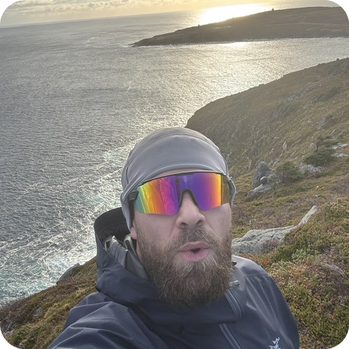

  <picture>
    <source media="(prefers-color-scheme: dark)" srcset="https://raw.githubusercontent.com/DangoKangoo/DangoKangoo/output/github-snake-dark.svg" />
    
  </picture>

### About

Software engineer building **scalable systems** across full-stack web, e-commerce and machine learning.

- Working with **clients across the country**
- **Machine learning & computer vision**, from research to production apps
- **Open to work**: let's build something together
- Off the keyboard: **golf** and **hiking**

  
  
  

 

### Tech Stack

   
  

### Featured Projects

| Project | What it is |
|---|---|
| [Twin Arrows Golf](https://twinarrowsgolf.com) | Storefront with US duties & shipping logic |
| [Dormston Indoor Golf](https://www.dormstongolf.com) | Golf simulator venue site with online bay booking and local SEO |
| [DeepSkin](https://github.com/DangoKangoo/DeepSkin-Replication-and-Extension) | Replication of DeepSkin (IEEE Access 2023): DenseNet169 vs EfficientNet-B0 on HAM10000, with GradCAM + SHAP |
| [Solar Inspection AI](https://github.com/DangoKangoo/solar-inspection-ai) | Streamlit app that scores solar panel images with a ResNet model + Grad-CAM |

### Stats

  

