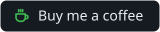
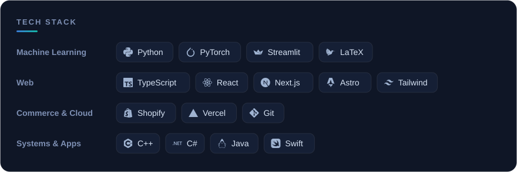

  <picture>
    <source media="(prefers-color-scheme: dark)" srcset="https://raw.githubusercontent.com/DangoKangoo/DangoKangoo/output/github-snake-dark.svg" />
    
  </picture>

### About

Software engineer building **scalable systems** across full-stack web, e-commerce and machine learning.

- Working with **clients across the country**
- **Machine learning & computer vision**, from research to production apps
- **Open to work**: let's build something together
- Off the keyboard: **golf** and **hiking**

  <a href="https://www.linkedin.com/in/will-odriscoll"><picture><source media="(prefers-color-scheme: light)" srcset="assets/btn-linkedin-light.svg" /></picture></a>
  <a href="mailto:willod17@outlook.com"><picture><source media="(prefers-color-scheme: light)" srcset="assets/btn-email-light.svg" /></picture></a>
  <a href="https://buymeacoffee.com/willodriscoll"><picture><source media="(prefers-color-scheme: light)" srcset="assets/btn-coffee-light.svg" /></picture></a>

<picture>
  <source media="(prefers-color-scheme: light)" srcset="assets/stack-light.svg" />
  
</picture>
